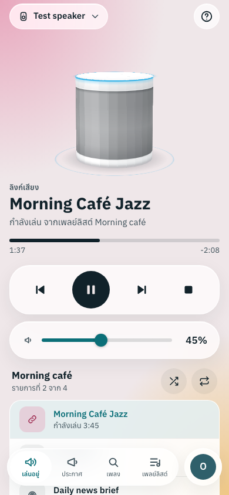
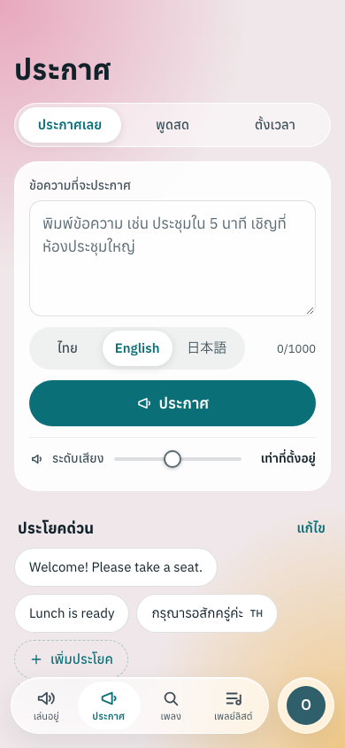
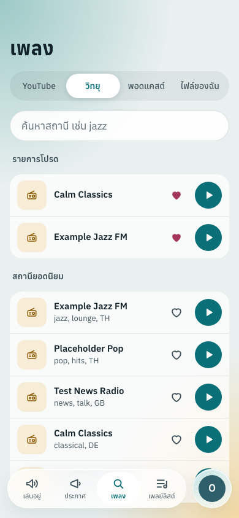
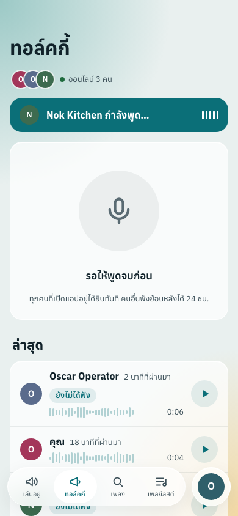
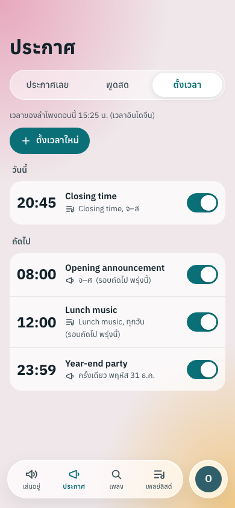
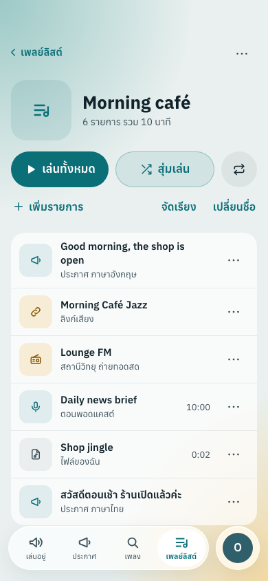

# Xiaomi-Smart-Speaker-Web-Controller

[English](README.en.md) | ภาษาไทย

[](https://github.com/jacksontae/Xiaomi-Smart-Speaker-Web-Controller/actions/workflows/ci.yml)
[](LICENSE)

## ลำโพงบ้านคุณ เป็นระบบประกาศได้ในมือถือเครื่องเดียว

เปลี่ยน Xiaomi Mi Smart Speaker (หรือลำโพง Google Cast ตัวไหนก็ได้) ให้เป็นทั้งเครื่องเล่นเพลง ระบบเสียงตามสาย และวิทยุสื่อสาร
ของบ้านหรือร้าน สั่งจากเว็บแอปที่เปิดได้ทุกเครื่อง ไม่ต้องพูดกับ Google Assistant และไม่ต้องลงแอปเพิ่ม
บน iPhone กด "เพิ่มไปยังหน้าจอโฮม" ใน Safari ก็ได้แอปเต็มจอเหมือนแอปจริง

<table>
<tr><td align="center" width="33%"><br><sub>กำลังเล่น</sub></td><td align="center" width="33%"><br><sub>ประกาศ</sub></td><td align="center" width="33%"><br><sub>วิทยุ</sub></td></tr>
<tr><td align="center" width="33%"><br><sub>ทอล์คกี้</sub></td><td align="center" width="33%"><br><sub>ตั้งเวลา</sub></td><td align="center" width="33%"><br><sub>เพลย์ลิสต์</sub></td></tr>
</table>

- **ประกาศได้ทันที** พิมพ์ข้อความแล้วลำโพงอ่านให้ ทั้งไทย อังกฤษ และญี่ปุ่น เก็บประโยคที่ใช้บ่อยไว้กดครั้งเดียว
  ประกาศแทรกเพลงที่เล่นอยู่แล้วกลับมาเล่นต่อให้เอง
- **ฟังได้ทุกอย่าง** YouTube แบบเสียงล้วนไม่มีโฆษณาแทรก (ตัดช่วงสปอนเซอร์ได้ด้วย SponsorBlock) วิทยุออนไลน์ พอดแคสต์ที่ติดตาม
  แล้วรู้ทันทีเมื่อมีตอนใหม่ และไฟล์เสียงของคุณเอง
- **เพลย์ลิสต์และคิว** รวมเพลง สถานีวิทยุ ตอนพอดแคสต์ และข้อความประกาศไว้ในลิสต์เดียว สุ่มเล่น เล่นวน จัดลำดับได้
- **ตั้งเวลาล่วงหน้า** เปิดร้านตอนเช้า เพลงช่วงพักเที่ยง ประกาศปิดร้าน เลือกวันในสัปดาห์หรือครั้งเดียวก็ได้
- **พูดผ่านลำโพงสดๆ** กดไมค์ในมือถือแล้วเสียงออกลำโพงทันที
- **ทอล์คกี้** วิทยุสื่อสารในทีม ทุกคนที่เปิดแอปได้ยินสด คนที่พลาดกดฟังย้อนหลังได้ภายใน 24 ชั่วโมง
- **ใช้ร่วมกันหลายคนอย่างปลอดภัย** แบ่งสิทธิ์เจ้าของ ผู้ควบคุม และผู้ชม ล็อกอินด้วยรหัสผ่าน passkey หรือบัญชี Google
  ดูได้ว่าใครสั่งอะไรเมื่อไหร่
- **สั่งจากที่ไหนก็ได้** วาง service บน VM แล้วให้บอร์ด ESP32 ราคาไม่กี่ร้อยบาทในบ้านเป็นตัวกลางคุยกับลำโพง
  ผ่าน MQTT และ Cloudflare Tunnel โดยไม่ต้องเปิดพอร์ตบ้าน
- **ของคุณเองทั้งหมด** โอเพนซอร์ส (MIT) รันด้วย Docker ข้อมูลอยู่ในเครื่องคุณ ใช้ได้ทั้งโหมดสว่างและมืด ภาษาไทยและอังกฤษ
  บน Android หน้าตาปรับเป็นแบบ Material ให้เข้ากับเครื่องเอง

ภาพหน้าจอทุกหน้า ทุกอุปกรณ์ (iPhone, iPad, เดสก์ท็อป, Android) อยู่ใน [docs/design](docs/design/README.md)
ข้อมูลในภาพเป็นข้อมูลตัวอย่างทั้งหมด

## ทำงานอย่างไร

Custom web controller with support for ESP32, ESP8266, macOS, and Linux.

Control a Google Cast speaker such as the **Xiaomi Mi Smart Speaker** from your own code, with no Google Assistant:
text-to-speech announcements, YouTube audio, volume and playback control, through an HTTP API and a small web UI.
The service talks to the speaker over the local network with the Cast protocol, and the speaker fetches audio from the service.

> **Status:** the Python service runs in Docker, both at home next to the speaker (e.g. on a Mac) and on a Linux VM.
> The relay firmware (see [firmware/](firmware/README.md)) is tested on an ESP32 (`esp32dev`) over plain MQTT and
> MQTT over WebSocket; ESP32-S3 and ESP8266 build but are not yet tested on hardware. Full English guide:
> [README.en.md](README.en.md).

HTTP API และหน้าเว็บสำหรับสั่ง Google Cast speaker (เช่น Xiaomi Mi Smart Speaker) ให้ประกาศข้อความและเล่นเสียงจาก YouTube
ผ่านโปรโตคอล Cast ในวง LAN โดยไม่ต้องพึ่ง Google Assistant ลำโพงดึงไฟล์เสียงทั้งหมดจาก service นี้

## ติดตั้ง (Docker)

service รันด้วย Docker ทั้งสองแบบ ใช้ image เดียวกัน (`Dockerfile`)

| แบบ | ไฟล์ compose | สั่งลำโพงอย่างไร |
|---|---|---|
| ที่บ้าน / วง LAN เช่น Mac ที่อยู่วงเดียวกับลำโพง | `compose.yaml` | Cast ตรง ลำโพงดึงเสียงจากเครื่องนี้ |
| VM ระยะไกล | `deploy/vm/compose.yaml` | ผ่าน ESP32 relay ทาง MQTT พร้อม Mosquitto, `cloudflared` และ backup รายคืน |

`scripts/speaker` ครอบ Docker Compose ให้ทั้งสองแบบ (ใส่ `--vm` เพื่อเลือกชุดของ VM)

```bash
scripts/speaker up                # build แล้วเปิด (สั่งอีกครั้งหลังแก้ .env หรือ pull)
scripts/speaker status            # สถานะ container
scripts/speaker logs [n] [service]   # ดู log แบบ follow (แสดง n บรรทัดล่าสุดก่อน ค่าเริ่มต้น 50)
scripts/speaker restart [service]
scripts/speaker down              # ปิด · ฐานข้อมูล ตั้งค่า และ backup ยังอยู่ใน volume
scripts/speaker update            # backup, git pull, build ใหม่ (ได้ yt-dlp ล่าสุด) แล้วเปิดใหม่
scripts/speaker backup | backups  # backup ทันที | ดูรายการ backup
scripts/speaker config            # แก้ config.json แล้วรีสตาร์ท
scripts/speaker token             # แสดง API token · --rotate เพื่อออก token ใหม่ (ของเดิมและลิงก์สื่อเดิมใช้ไม่ได้ทันที)
```

container เปิดใหม่เองถ้าตาย (`restart: unless-stopped`) รวมถึงหลังรีบูตเมื่อ Docker เปิดแล้ว ไม่มี access log
(มีแค่ข้อความตอนเริ่ม คำเตือน และ error) ใน container `config.json`, `data.db`, `media/` และ cache YouTube อยู่ใน volume
`speaker-data` ที่ `/data`

### ที่บ้าน / วง LAN (Mac)

ต้องมี Docker Desktop (`brew install --cask docker` แล้วเปิดครั้งหนึ่ง และเปิด "Start Docker Desktop when you sign in")
ffmpeg และ Node.js อยู่ใน image แล้ว

```bash
git clone git@github.com:jacksontae/Xiaomi-Smart-Speaker-Web-Controller.git
cd Xiaomi-Smart-Speaker-Web-Controller
cp .env.example .env      # ตั้ง PUBLIC_BASE_URL (ดูด้านล่าง) และ TZ
scripts/speaker up
scripts/speaker token     # ใช้สร้างบัญชี admin คนแรก
```

หน้าควบคุม: http://<ip เครื่องนี้>:8090/ · เอกสาร API: http://<ip>:8090/docs เปิดครั้งแรกหน้าเว็บจะขอ API token
เพื่อสร้าง admin คนแรก แล้วตั้ง `speaker_ip` ในหน้า "ตั้งค่า" (หรือ `scripts/speaker config`)

**ทำไมต้องตั้ง `PUBLIC_BASE_URL`:** ลำโพงเล่นจากลิงก์ที่ชี้กลับมาที่ service แต่ Docker Desktop รัน container ใน VM เล็กๆ
ใน container จึงเห็นแค่ IP ภายใน (172.x) ซึ่งลำโพงเข้าไม่ถึง `PUBLIC_BASE_URL` ใน `.env` บอก service ว่าให้ใช้ IP ของเครื่องนี้ในวง LAN
กับพอร์ตที่เปิดไว้แทน เช่น `http://192.0.2.20:8090` ควรจอง IP ของ Mac ไว้ใน router (DHCP reservation) ถ้า IP เปลี่ยนให้แก้ `.env`
แล้ว `scripts/speaker up` พอร์ต 8090 เปิดทุก interface เหมือนเดิม ครั้งแรกถ้า macOS firewall ถามให้อนุญาต Docker

สิ่งที่ต่างไปเมื่อรันใน Docker บน Mac:

- **ปุ่ม "ค้นหา" ลำโพงจะไม่เจออะไร** เพราะใช้ mDNS multicast ซึ่งไปไม่ถึง container ให้ใส่ IP ลำโพงเอง ส่วนอื่นคุยกับลำโพงด้วย IP
  การเล่นจึงไม่กระทบ
- **ทุกเบราว์เซอร์อาจเห็นเป็น IP เดียวกัน** (gateway ของ Docker Desktop) ในบันทึกกิจกรรมและตัวจำกัดการล็อกอิน เพราะ port forwarding
  ของ Docker Desktop ไม่ส่ง IP จริงของผู้ใช้ต่อ
- **ตารางเวลา** ใช้ `TZ` จาก `.env` (container ไม่รู้ time zone ของ Mac)
- **Backup:** service `backup` เขียน backup รายคืนลงโฟลเดอร์ `./backups` (โฟลเดอร์ธรรมดา Time Machine จึงสำรองให้ด้วย)
  ดู [Backups and restore](#backups-and-restore)

### VM ระยะไกล

`deploy/vm/compose.yaml` รัน service พร้อม Mosquitto, `cloudflared` และ backup รายคืน แล้วสั่งลำโพงผ่าน ESP32 relay ทาง MQTT
ขั้นตอนอยู่ในหัวข้อ Remote deployment ด้านล่าง ใช้ helper แบบ `--vm` (`scripts/speaker --vm up`) หรือสั่ง Compose ตรงจาก checkout:
`docker compose -f deploy/vm/compose.yaml up -d --build`

- พอร์ต 8090 ผูกกับ loopback ของ VM (`127.0.0.1:8090`) เท่านั้น จะเปิดหน้าเว็บโดยไม่ผ่าน tunnel ใช้ SSH tunnel: `ssh -L 8090:127.0.0.1:8090 <vm>`
- `cloudflared` ต้องรันจาก compose file (ชื่อ `speaker-service`, `mosquitto` รู้จักเฉพาะใน compose network) ถ้าติดตั้ง `cloudflared` บน host ด้วย tunnel จะตอบ `502`
- compose network ใช้ subnet คงที่ (`172.30.77.0/24`) และ `cloudflared` มี IP คงที่ในนั้น service เชื่อ `X-Forwarded-For` จาก IP นั้นเท่านั้น (`FORWARDED_ALLOW_IPS`) Activity และตัวจำกัดการล็อกอินจึงเห็น IP จริงของแต่ละคน ถ้า subnet ชนกับของ VM ให้แก้ทั้ง 3 ค่าพร้อมกัน แล้ว `docker compose down` ก่อน `up -d` (Compose ไม่แก้ network ที่มีอยู่แล้ว)
- ชื่อ Compose project ถูกตรึงไว้ (`name: remote` จากตอนที่ชุดนี้อยู่ใน `deploy/remote/`) volume จึงยังเป็น `remote_speaker-data`,
  `remote_speaker-backups` และ `remote_mosquitto-data` ห้ามเปลี่ยน ถ้าชื่อเปลี่ยน service จะเริ่มบน volume ใหม่ที่ว่างเปล่า

### ย้ายจาก LaunchAgent (`speakerctl`)

เวอร์ชันก่อนรันบน Mac เป็น LaunchAgent ที่จัดการด้วย `./speakerctl` โดยเก็บ `config.json`, `data.db` และ `media/` ไว้ในโฟลเดอร์ repo
หลัง pull เวอร์ชันนี้ ทำครั้งเดียว:

```bash
launchctl bootout gui/$(id -u)/local.speaker-service      # หยุด service เดิม (เหมือน "speakerctl stop")
rm ~/Library/LaunchAgents/local.speaker-service.plist      # เลิกเปิดอัตโนมัติ (เหมือน "speakerctl uninstall")
cp .env.example .env                                       # ตั้ง PUBLIC_BASE_URL และ TZ
scripts/speaker import .                                   # คัดลอก config.json, data.db, media/ เข้า volume แล้วเปิด
```

`import` จะไม่ทำงานถ้า agent เดิมยังรันอยู่ ของที่มีอยู่แล้วใน volume เก็บไว้เป็น `*.before-import-<เวลา>` และตั้ง `port` ใน
`config.json` เป็น 8090 (พอร์ตใน container ส่วนพอร์ตบน Mac คือ `SPEAKER_PORT` ใน `.env`) cache YouTube ไม่ได้คัดลอก เดี๋ยวโหลดใหม่เอง
ตรวจหน้าเว็บให้เรียบร้อยแล้วค่อยลบไฟล์เก่าในโฟลเดอร์ repo (`config.json`, `data.db*`, `media/`, `cache/`, `service.log`, `.venv/`)

ชุดของ VM ย้ายจาก `deploy/remote/` ไป `deploy/vm/` ชื่อ project ตรึงเป็นชื่อเดิม (`name: remote`) container และ volume จึงเป็นชุดเดิม
แต่ไฟล์ลับที่ git ignore ไม่ย้ายตาม `git pull` ให้ย้ายเองครั้งเดียวแล้วเปิดตามปกติ:

```bash
mv deploy/remote/.env deploy/vm/.env
mv deploy/remote/mosquitto/passwd deploy/remote/mosquitto/acl deploy/vm/mosquitto/
scripts/speaker --vm up        # = docker compose -f deploy/vm/compose.yaml up -d --build
```

`scripts/speaker --vm` จะไม่ทำงานถ้าไฟล์เหล่านี้ยังอยู่แค่ใน `deploy/remote/` และ Compose จะหยุดพร้อม error ถ้า `deploy/vm/.env` ขาดค่าที่จำเป็น

## ตั้งค่า

แก้ได้ 3 ทาง: หน้าเว็บ (หัวข้อ "ตั้งค่า"), `POST /settings`, หรือ `scripts/speaker config` (แก้ `config.json` ใน volume แล้วรีสตาร์ท)

| key | ค่าเริ่มต้น | ความหมาย |
|---|---|---|
| `speaker_ip` | `192.0.2.10` | IP หรือ hostname ของลำโพง (กด "ค้นหา" ในหน้าเว็บเพื่อเลือกจากลำโพงในวง LAN ใช้ไม่ได้ใน Docker บน Mac ให้ใส่เอง) |
| `speaker_name` | `Air Purifier speaker` | ชื่อที่แสดง (1–64 ตัวอักษร) |
| `port` | `8090` | พอร์ตของ service 1024–65535 (เปลี่ยนแล้วรีสตาร์ทเอง) |
| `default_volume` | `null` | ระดับเสียงที่ตั้งก่อนประกาศหรือเล่น 0–1, `null` = ไม่เปลี่ยน |
| `tts_lang` | `th` | ภาษาเริ่มต้นของ `/say` |
| `cache_keep` | `20` | จำนวนเพลง YouTube ที่เก็บใน `cache/` |
| `yt_skip_segments` | `["interaction", "selfpromo", "sponsor"]` | ตัดช่วงสปอนเซอร์ที่ครีเอเตอร์พูดเองในวิดีโอ YouTube ออกหลังดาวน์โหลด (ฐานข้อมูลสาธารณะ SponsorBlock, ต้องมี ffmpeg) · `[]` = ปิด · ดูหัวข้อ "โฆษณา YouTube" |
| `resume_after_say` | `true` | ประกาศเสร็จแล้วเล่นเพลง YouTube ที่ค้างอยู่ต่อจากจุดเดิม (ย้อน 1 วินาที) |
| `talk_max_seconds` | `120` | พูดสดได้นานสุดกี่วินาทีต่อครั้ง (10–600) |
| `transport` | `cast` | `cast` = สั่งลำโพงตรงในวง LAN · `mqtt` = สั่งผ่าน ESP32 relay (ดู Remote deployment) |
| `mqtt` | ดู `config.example.json` | broker ของ relay: `host`, `port`, `tls`, `ca_file`, `username`, `password`, `base_topic`, `client_id` · เวลา: `keepalive`, `offline_after`, `status_refresh`, `command_timeout`, `play_timeout`, `reconnect_min`, `reconnect_max` |
| `public_base_url` | `null` | ใส่เมื่อ IP ของ Mac ที่ตรวจเองผิด เช่น `http://192.0.2.20:8090` (ใน Docker บน Mac ตั้งผ่าน `PUBLIC_BASE_URL` ใน `.env` เสมอ) · host ของ URL นี้คือ RP ID ของ passkey |
| `google_client_id` | `null` | OAuth client ID สำหรับ "Sign in with Google" เช่น `1234-abc.apps.googleusercontent.com` (ไม่ใช่ความลับ) |
| `google_signin` | `false` | เจ้าของ (admin) เปิด/ปิดการล็อกอินด้วย Google · เปิดได้เมื่อมี `google_client_id` แล้ว |
| `passkey_signin` | `true` | เปิดการล็อกอินด้วย passkey (ใช้ได้จริงเมื่อ `public_base_url` เป็น `https://` หรือ `http://localhost`) |
| `passkey_required_for_admins` | `false` | admin ที่มี passkey ต้องล็อกอินด้วย passkey เท่านั้น (เปิดได้เมื่อ admin ทุกคนมี passkey แล้ว) |
| `owner_contact` | `null` | ช่องทางติดต่อเจ้าของ เช่น `it@example.com` หรือ LINE id (ไม่เกิน 120 ตัวอักษร) แสดงในหน้าเกี่ยวกับแอปเฉพาะสมาชิกที่เข้าสู่ระบบแล้ว |
| `cookie_secure` | `"auto"` | flag `Secure` ของ cookie `sid` · `"auto"`: ใส่เมื่อคำขอมาทาง https หรือมาที่ host ของ `public_base_url` ที่เป็น `https://` (proxy ที่ถอด TLS แล้วส่งต่อเป็น http เช่น Cloudflare Tunnel) · `true`: ใส่เสมอ (ล็อกอินได้เฉพาะทาง https หรือ `http://localhost`) · `false`: ไม่ใส่ · env `COOKIE_SECURE` |

```bash
TOKEN=$(scripts/speaker token)
curl -X POST localhost:8090/settings -H "Authorization: Bearer $TOKEN" -H 'Content-Type: application/json' -d '{"default_volume":0.4}'
curl -H "Authorization: Bearer $TOKEN" localhost:8090/speakers    # ค้นหาลำโพง Cast ในวง LAN
```

## API

เรียก API ได้ 2 แบบ ถ้าไม่ได้ยืนยันตัวตนจะได้ `401` ถ้าสิทธิ์ไม่พอจะได้ `403` (body เป็น `{"detail": "..."}` เสมอ)

- **API token** ส่ง header `Authorization: Bearer <token>` ได้สิทธิ์ `admin` ใช้กับ curl, integration และ firmware relay
  - token สร้างให้อัตโนมัติตอนเปิด service ครั้งแรก เก็บใน `config.json` (สิทธิ์ไฟล์ 600) ดูด้วย `scripts/speaker token` (บน VM `scripts/speaker --vm token`)
  - `GET /settings` ไม่ส่ง token กลับไป และเปลี่ยน token ผ่าน API ไม่ได้ ใช้ `scripts/speaker token --rotate`
- **บัญชีผู้ใช้ (หน้าเว็บ)** ล็อกอินแล้วได้ cookie `sid` (`HttpOnly`, `SameSite=Strict`, อายุ 30 วันนับจากใช้งานล่าสุด, `Secure` เมื่อใช้ https ดู `cookie_secure`) · session ที่หมดอายุถูกลบตอนเริ่ม service และทุกชั่วโมง
  - คำขอที่เปลี่ยนข้อมูล (POST/PUT/PATCH/DELETE) ด้วย cookie ต้องส่ง header `X-Requested-With: speaker-web` ไม่งั้นได้ `403`
  - ครั้งแรกที่ยังไม่มีผู้ใช้ หน้าเว็บจะให้ใส่ API token เพื่อสร้างบัญชี admin คนแรก (`POST /auth/setup`)
  - รหัสผ่าน 8–256 ตัว เก็บแบบ scrypt · ล็อกอินผิด 5 ครั้งใน 5 นาที (ต่อ IP + ชื่อผู้ใช้) จะได้ `429` พร้อม `Retry-After`
- ไฟล์เสียงที่ลำโพงดึง (`/tts.mp3`, `/yt/...`, `/media/...`, `/talk/...`) ไม่ใช้ header เพราะลำโพงส่งไม่ได้ แต่ใช้ลิงก์ที่เซ็นด้วย HMAC ของ token และหมดอายุใน 6 ชั่วโมงแทน
- ข้อมูลผู้ใช้ เพลย์ลิสต์ ข้อความด่วน ตารางเวลา สถานีโปรด ข้อมูลไฟล์อัปโหลด และบันทึกกิจกรรม เก็บใน SQLite ที่ `data.db` (เปลี่ยนที่ได้ด้วย env `DATA_PATH`)

### สิทธิ์ (role)

| role | ทำอะไรได้ |
|---|---|
| `viewer` | ดูสถานะ คิว เพลย์ลิสต์ที่แชร์ และข้อความด่วน · ข้ามเพลง/ย้อน/เลือกเพลงในคิวของลำโพง · ค้นเพลง เล่นที่อุปกรณ์นี้ · อัปโหลดไฟล์และทำเพลย์ลิสต์ของตัวเอง (ส่วนตัว) · ทอล์คกี้ |
| `operator` | viewer + ประกาศ เล่น ปรับเสียง หยุด/เล่นต่อ คุมคิว แก้เพลย์ลิสต์ที่แชร์และข้อความด่วน |
| `admin` | operator + จัดการสมาชิก ตั้งค่า ค้นหาลำโพง ดูบันทึกกิจกรรม |

### บัญชี

| Method | Path | สิทธิ์ | Body | หน้าที่ |
|---|---|---|---|---|
| GET | `/auth/state` | ทุกคน | – | `{"needs_setup", "user", "methods": {"password", "google", "passkey"}}` + `google_client_id` เมื่อเปิด Google (+ `passkey_required` เมื่อ admin ต้องเพิ่ม passkey) |
| GET | `/about` | ทุกคน | – | `{"version", "build"}` (เวอร์ชันแอป, build id ของไฟล์ static) + `server: {"speaker", "transport", "owner_contact"}` เมื่อล็อกอินแล้ว |
| POST | `/auth/setup` | ทุกคน (ตอนยังไม่มีผู้ใช้) | `{"api_token", "username", "display_name", "password"}` | สร้าง admin คนแรกแล้วล็อกอิน (token ผิด `401`, มีผู้ใช้แล้ว `409`) |
| POST | `/auth/login` | ทุกคน | `{"username", "password"}` | ล็อกอิน ตั้ง cookie |
| POST | `/auth/logout` · `/auth/logout-all` | ล็อกอินแล้ว | – | ออกจากระบบเครื่องนี้ · ทุกเครื่อง |
| POST | `/auth/password` | ล็อกอินแล้ว | `{"current", "new"}` | เปลี่ยนรหัสผ่าน (เครื่องอื่นถูกออกจากระบบ) |
| POST | `/auth/google` | ทุกคน | `{"credential"}` | ล็อกอินด้วย Google ID token (เฉพาะบัญชีที่ผูกไว้แล้ว `401` ถ้ายังไม่ผูก, ปิดอยู่ `409`) |
| POST · DELETE | `/me/google` | ล็อกอินแล้ว | `{"credential"}` · – | ผูก · ยกเลิกการผูกบัญชี Google กับบัญชีตัวเอง (ผูกกับคนอื่นแล้ว `409`) |
| POST | `/auth/passkey/options` | ทุกคน | – | `{"publicKey"}` สำหรับ `navigator.credentials.get()` |
| POST | `/auth/passkey/verify` | ทุกคน | `{"credential"}` | ล็อกอินด้วย passkey ตั้ง cookie (ไม่ผ่าน `401`) |
| POST | `/me/passkeys/options` | ล็อกอินแล้ว | – | `{"publicKey"}` สำหรับ `navigator.credentials.create()` |
| GET · POST | `/me/passkeys` | ล็อกอินแล้ว | `{"credential", "name"}` | ดู · เพิ่ม passkey ของตัวเอง |
| PATCH · DELETE | `/me/passkeys/{id}` | ล็อกอินแล้ว | `{"name"}` · – | เปลี่ยนชื่อ · ลบ passkey |
| GET | `/me/export` | ล็อกอินแล้ว | – | ดาวน์โหลดข้อมูลของตัวเองเป็น JSON (`speaker-my-data-YYYY-MM-DD.json`): โปรไฟล์ ชื่อ passkey เซสชัน เพลย์ลิสต์และไฟล์ส่วนตัว (ชื่อและขนาด) พอดแคสต์ที่ติดตาม คลิป Talkie และ activity ของตัวเอง |
| DELETE | `/me` | ล็อกอินแล้ว | `{"confirm": "<ชื่อผู้ใช้ของตัวเอง>"}` | ลบบัญชีตัวเองพร้อมทุกอย่างที่เป็นของส่วนตัว แล้วออกจากระบบ (ชื่อผู้ใช้ไม่ตรง `400`, เป็นเจ้าของคนเดียว `409`) |
| GET · POST | `/users` | admin | `{"username", "display_name", "password", "role"}` | ดู · เพิ่มสมาชิก |
| PATCH · DELETE | `/users/{id}` | admin | `{"display_name", "role", "password", "disabled"}` (ใส่เฉพาะที่จะแก้) | แก้ · ลบสมาชิก |

ชื่อผู้ใช้ 3–32 ตัว `a-z 0-9 . _ -` · ลบ (ยกเว้นผ่าน `DELETE /me`) ปิด หรือลดสิทธิ์ตัวเองไม่ได้ และต้องเหลือ admin ที่เปิดใช้อย่างน้อย 1 คน (`409`)
ปิดบัญชีหรือเปลี่ยนรหัสผ่านจะออกจากระบบทุกเครื่องของคนนั้น
`/me`, `/me/*`, `/auth/password` และ `/auth/logout-all` ต้องเป็นบัญชีผู้ใช้ เรียกด้วย API token ได้ `400`

#### Sign in with Google

1. สร้าง OAuth client ID ชนิด "Web application" ใน Google Cloud console แล้วใส่ origin ของหน้าเว็บ
   (เช่น `https://speaker.example.com`) ใน "Authorized JavaScript origins"
2. ใส่ `google_client_id` แล้วเปิด `google_signin` ในหน้าตั้งค่า (หรือ `POST /settings`)
3. สมาชิกล็อกอินด้วยรหัสผ่านก่อน แล้วกด "ผูกบัญชี Google" ในหน้าบัญชี จากนั้นจึงล็อกอินด้วย Google ได้ ไม่มีการสมัครเอง

service ตรวจลายเซ็น ID token กับ key ของ Google (cache 1 ชั่วโมง) รวมถึง `aud`, `iss`, `exp` และ `email_verified`
และเก็บ Google subject id (`sub`) ไม่ใช่แค่อีเมล token หนึ่งใช้ได้ครั้งเดียว · ผิด 5 ครั้งใน 5 นาที (ต่อ IP) ได้ `429`
ยกเลิกการผูกไม่ได้ถ้าเป็นวิธีล็อกอินเดียวที่เหลือ (`409`)
#### Passkeys

ใช้ได้เมื่อเปิดหน้าเว็บผ่าน `public_base_url` ที่เป็น `https://` (หรือ `http://localhost` ตอนพัฒนา) เพราะเบราว์เซอร์ไม่ให้ใช้ passkey
บน http หรือ IP · RP ID = host ของ `public_base_url` ถ้าเปลี่ยนโดเมน passkey เดิมจะใช้ไม่ได้
`credential` คือ `PublicKeyCredential` ที่แปลงเป็น JSON (ฟิลด์ binary เป็น base64url เหมือน `credential.toJSON()`)
challenge ใช้ได้ครั้งเดียวและหมดอายุใน 5 นาที · ตรวจ sign counter (ค่าไม่เพิ่ม = key ถูกคัดลอก ปฏิเสธ) · ผิด 5 ครั้งใน 5 นาที (ต่อ IP) ได้ `429`
ลบ passkey สุดท้ายไม่ได้ถ้าเป็นวิธีล็อกอินเดียวที่เหลือ หรือเป็น admin ขณะเปิด `passkey_required_for_admins` (`409`)
เมื่อเปิด `passkey_required_for_admins` admin ที่มี passkey ล็อกอินด้วยรหัสผ่านหรือ Google ไม่ได้ (`403`) · admin ใหม่ที่ยังไม่มี passkey
ยังล็อกอินด้วยรหัสผ่านได้ แต่ `/auth/state` จะมี `"passkey_required": true` ให้หน้าเว็บพาไปเพิ่ม · API token ใช้ได้เสมอ (ทางกู้คืน)

### ลำโพง

| Method | Path | สิทธิ์ | Body | หน้าที่ |
|---|---|---|---|---|
| GET | `/status` | viewer | – | แอป เพลง (มี `media.thumbnail`) ระดับเสียง คิว (`queue`) และ `talking` · admin ได้ `relay` ด้วย |
| POST | `/say` | operator | `{"text": "...", "lang": "th", "volume": 0.4}` | ประกาศข้อความ (TTS) |
| POST | `/youtube` | operator | `{"query": "คำค้น หรือ URL", "volume": 0.3}` | เล่นเสียงจาก YouTube (ล้างคิว) |
| GET | `/youtube/search?q=...&limit=8` | operator | – | ค้นหา YouTube (ไม่ดาวน์โหลด) |
| POST | `/play` | operator | `{"url": "...", "content_type": "audio/mp3"}` | เล่นไฟล์เสียงจาก URL (ล้างคิว) |
| POST | `/volume` | operator | `{"level": 0.3}` | ปรับเสียง 0–1 |
| POST | `/pause` · `/resume` · `/stop` | operator | – | ควบคุมการเล่น (`stop` ล้างคิวด้วย) |
| GET · POST | `/settings` | admin | `{"default_volume": 0.4}` | ดู · แก้ตั้งค่า |
| GET | `/speakers` | admin | – | ค้นหาลำโพง Cast ในวง LAN |
| GET | `/activity?limit=50&before_id=` | admin | – | บันทึกกิจกรรม ใหม่สุดก่อน (`limit` ไม่เกิน 500 · เก็บ 5000 รายการล่าสุดภายใน 90 วัน) |

### เพลย์ลิสต์และคิว

| Method | Path | สิทธิ์ | Body | หน้าที่ |
|---|---|---|---|---|
| GET · POST | `/playlists` | viewer | `{"name", "personal": false}` | รายการเพลย์ลิสต์ที่เห็นได้ · สร้างใหม่ |
| GET · PATCH · DELETE | `/playlists/{id}` | viewer | `{"name"}` | ดูพร้อมรายการ · เปลี่ยนชื่อ · ลบ |
| POST | `/playlists/{id}/items` | viewer | `{"kind": "youtube"\|"url"\|"tts"\|"radio"\|"podcast"\|"file", "source", "title", "lang", "thumbnail", "duration", "content_type"}` | เพิ่มรายการ (ไม่เกิน 500 รายการต่อเพลย์ลิสต์ เกิน `409`) |
| DELETE | `/playlists/{id}/items/{item_id}` | viewer | – | ลบรายการ |
| PUT | `/playlists/{id}/order` | viewer | `{"item_ids": [...]}` | เรียงใหม่ (ต้องครบทุก id พอดี ไม่งั้น `409`) |
| POST | `/playlists/{id}/play` | operator | `{"start_index": 0, "shuffle": false, "repeat": "off"\|"all"\|"one"}` | เล่นทั้งเพลย์ลิสต์เป็นคิว |
| GET · PATCH | `/queue` | viewer · operator | `{"shuffle", "repeat"}` | ดูคิว (`null` ถ้าไม่มี) · สลับ shuffle/repeat |
| POST | `/queue/next` · `/queue/prev` · `/queue/jump` | viewer | `{"index"}` (เฉพาะ jump) | ข้ามเพลง |
| POST | `/queue/clear` | operator | – | ล้างคิวและหยุดเล่น |
| GET · POST | `/phrases` | viewer · operator | `{"text", "lang"}` | ข้อความด่วน (กดแล้วหน้าเว็บเรียก `/say`) |
| DELETE | `/phrases/{id}` | operator | – | ลบข้อความด่วน |

- เพลย์ลิสต์ส่วนตัว: `owner_id` เป็น id ของเจ้าของ (`null` = แชร์ ทุกเพลย์ลิสต์ที่มีก่อน schema 6 เป็นแบบแชร์) ผลลัพธ์มี `owner_id`, `owner_name`, `mine` และ `can_edit` (ผู้เรียกแก้ได้ไหม)
  - viewer สร้างได้เฉพาะแบบส่วนตัว · operator/admin สร้างแบบแชร์ เว้นแต่ส่ง `"personal": true` (API token สร้างแบบส่วนตัวไม่ได้ `400`)
  - เห็นได้: แบบแชร์ทุกคน · แบบส่วนตัวเฉพาะเจ้าของและ admin (operator ไม่เห็นของคนอื่น) ที่มองไม่เห็นตอบ `404` เสมอ
  - แก้ (เปลี่ยนชื่อ ลบ เพิ่ม/ลบ/เรียงรายการ): แบบแชร์ต้อง operator ขึ้นไป (viewer ได้ `403`) · แบบส่วนตัวเจ้าของหรือ admin
  - `/playlists/{id}/play` (เล่นที่ลำโพง) ยังเป็น operator และต้องมองเห็นเพลย์ลิสต์นั้น · ตารางเวลาเล่นได้เฉพาะเพลย์ลิสต์ที่แชร์ (แบบส่วนตัวได้ `400`)
  - รายการ `file` ต้องเป็นไฟล์ที่เจ้าของเพลย์ลิสต์มองเห็น (แบบแชร์ใส่ได้แค่ไฟล์แชร์ แบบส่วนตัวใส่ไฟล์แชร์หรือไฟล์ของเจ้าของ) ไม่งั้น `400`
  - ลบสมาชิกแล้ว เพลย์ลิสต์และไฟล์ส่วนตัวของเขา (รวมไฟล์บนดิสก์) ถูกลบด้วย ตารางเวลาที่เล่นเพลย์ลิสต์นั้นถูกปิด
- viewer คุมคิวของลำโพงได้แค่ next/prev/jump (ลง activity เหมือน operator) ส่วน shuffle/repeat ล้างคิว หยุด และเสียงยังเป็น operator
- รายการ `youtube` ใส่ได้ทั้ง URL, video id หรือคำค้น (เอาผลแรก) · `url` ต้องเป็นลิงก์ http(s) และต้องมี `title` · `tts` ยาวไม่เกิน 1000 ตัวอักษร
- `radio` ใส่ uuid ของสถานีจาก radio-browser หรือลิงก์ stream (ต้องมี `title`) · `podcast` ใส่ลิงก์ไฟล์ตอน (ต้องมี `title`) · `file` ใส่ id ของไฟล์ที่อัปโหลด (ลบไฟล์แล้วรายการนั้นหายจากเพลย์ลิสต์ด้วย)
- สถานีวิทยุในคิวเล่นแบบ LIVE ไม่มีวันจบ คิวจะค้างที่สถานีนั้นจนกด next
- คิวเลื่อนไปเพลงถัดไปเองเมื่อเพลงจบ (ประกาศจบไม่นับ) โหลดเพลง YouTube ถัดไปไว้ล่วงหน้า รายการที่โหลดไม่ได้จะถูกข้ามและบันทึกไว้
- `say` ระหว่างเล่นคิว: ประกาศจบแล้วเล่นเพลงเดิมต่อ แล้วคิวก็เดินต่อตามปกติ
- คิวอยู่ในหน่วยความจำ รีสตาร์ท service แล้วหาย และแก้เพลย์ลิสต์ระหว่างเล่นจะไม่กระทบคิวที่เล่นอยู่

```bash
TOKEN=$(scripts/speaker token)
curl -X POST localhost:8090/say -H "Authorization: Bearer $TOKEN" -H 'Content-Type: application/json' -d '{"text":"ค่าฝุ่นสูง กรุณาปิดหน้าต่าง"}'
curl -X POST localhost:8090/youtube -H "Authorization: Bearer $TOKEN" -H 'Content-Type: application/json' -d '{"query":"เพลงบรรเลงเปียโน"}'
curl -X POST localhost:8090/playlists/1/play -H "Authorization: Bearer $TOKEN" -H 'Content-Type: application/json' -d '{"shuffle":true,"repeat":"all"}'
```

### ตารางเวลา

| Method | Path | สิทธิ์ | Body | หน้าที่ |
|---|---|---|---|---|
| GET | `/schedules` | viewer | – | `{"timezone", "now", "items"}` |
| POST | `/schedules` | operator | `{"name", "enabled", "action", "text", "lang", "playlist_id", "shuffle", "volume", "time", "days", "date"}` | สร้างตารางเวลา |
| PATCH · DELETE | `/schedules/{id}` | operator | ฟิลด์ข้างบน (ใส่เฉพาะที่จะแก้) · – | แก้ · ลบ |
| POST | `/schedules/{id}/run` | operator | – | ทดสอบเล่นทันที (ไม่สนเวลาและ `enabled` · `next_run` ไม่เปลี่ยน) |

- `action` เป็น `say` (ต้องมี `text`, `lang` ไม่ใส่ก็ได้) หรือ `playlist` (ต้องมี `playlist_id`, `shuffle` ไม่ใส่ก็ได้) · `volume` 0–1 ไม่ใส่ก็ได้ · `name` ไม่เกิน 80 ตัวอักษร
- เล่นได้เฉพาะเพลย์ลิสต์ที่แชร์ (แบบส่วนตัวได้ `400`)
- `time` เป็น `HH:MM` (24 ชั่วโมง) ตามเขตเวลาของ server (env `TZ` ถ้าไม่มีใช้ของระบบ ถ้าไม่มีอีกใช้ UTC)
- `days` คือวันในสัปดาห์ `0` (จันทร์) ถึง `6` (อาทิตย์) สำหรับตารางที่ทำซ้ำ · `days` ว่าง = ครั้งเดียวในวันที่ `date` (`YYYY-MM-DD`) ห้ามเป็นอดีต เล่นแล้วปิดตัวเอง
- service ตรวจตารางที่ถึงเวลาทุก 15 วินาที · ช้าเกิน 5 นาที (เช่น service ปิดอยู่) จะข้ามและบันทึกเป็น `missed`
- แต่ละรายการมี `next_run`, `last_run`, `last_result` (`ok`, `missed` หรือข้อความ error)
- ตารางแบบเพลย์ลิสต์แทนที่คิวเดิมและเล่นแบบ repeat off · ถ้า `shuffle` เริ่มจากรายการสุ่ม

### แหล่งเพลง: วิทยุ พอดแคสต์ ไฟล์ของฉัน

| Method | Path | สิทธิ์ | Body / query | หน้าที่ |
|---|---|---|---|---|
| GET | `/radio/search?q=&country=TH&tag=&limit=20` | viewer | – | ค้นสถานีจาก [radio-browser.info](https://www.radio-browser.info) (เรียงตามความนิยม) |
| GET · POST | `/radio/favorites` | viewer · operator | `{"uuid"}` หรือ `{"url", "name"}` | สถานีโปรด · เพิ่ม (สถานี radio-browser เดียวกันซ้ำ `409` · ลิงก์ stream ของตัวเองซ้ำได้) |
| DELETE | `/radio/favorites/{id}` | operator | – | ลบสถานีโปรด |
| POST | `/radio/play` | operator | `{"favorite_id"}` หรือ `{"uuid"}` หรือ `{"url", "name"}` + `"volume"` | เล่นวิทยุแบบ LIVE (ล้างคิว) |
| GET | `/podcasts/search?q=&country=TH&limit=20` | viewer | – | ค้นรายการจาก iTunes Search API ได้ `feed_url` |
| GET | `/podcasts/episodes?feed=<feed_url>&limit=50` | viewer | – | อ่าน RSS ได้รายละเอียดรายการและตอนล่าสุด + `subscription` ของผู้เรียก (หรือ `null`) |
| GET · POST | `/podcasts/subs` | viewer | `{"feed_url", "title", "author", "artwork"}` | รายการที่ติดตาม (ส่วนตัว) พร้อม `new_count` · ติดตาม (ซ้ำได้ ได้แถวเดิม · ไม่ส่ง `title` จะอ่านจากฟีด) |
| POST | `/podcasts/subs/{id}/seen` | viewer | – | เปิดดูรายการแล้ว: ตอนที่มีอยู่ไม่นับเป็นตอนใหม่อีก |
| DELETE | `/podcasts/subs/{id}` | viewer | – | เลิกติดตาม |
| POST | `/podcasts/play` | operator | `{"url", "title", "thumbnail", "content_type", "volume"}` | เล่นตอนหนึ่ง (ล้างคิว) |
| GET | `/files` | viewer | – | `{"items", "used", "quota", "max_size", "types"}` (เฉพาะไฟล์ที่เห็นได้) |
| POST | `/files?name=<ชื่อไฟล์>&duration=<วินาที>&personal=1` | viewer | ตัวไฟล์เสียงเป็น body ตรงๆ (ไม่ใช่ form) | อัปโหลด |
| PATCH · DELETE | `/files/{id}` | viewer (ตามสิทธิ์ของไฟล์) | `{"title"}` | เปลี่ยนชื่อ · ลบ |
| POST | `/files/{id}/play` | operator | `{"volume"}` | เล่นไฟล์ (ล้างคิว) |

- ไฟล์ส่วนตัวใช้กติกาเดียวกับเพลย์ลิสต์: ของ viewer เป็นส่วนตัวเสมอ operator/admin แชร์ เว้นแต่ `personal=1` · เห็นได้เฉพาะไฟล์แชร์และของตัวเอง (admin เห็นทั้งหมด) ที่มองไม่เห็นตอบ `404` · แต่ละไฟล์มี `owner_id`, `owner_name`, `mine`, `can_edit`, `uploader_id`, `uploader` (คนอัปโหลด)
- แก้/ลบไฟล์: ไฟล์ส่วนตัว เจ้าของหรือ admin · ไฟล์แชร์ operator ที่อัปโหลดหรือ admin (viewer ได้ `403`) · โควตาพื้นที่ยังรวมทุกคน
- ไฟล์อัปโหลดตรวจชนิดจากเนื้อไฟล์ (mp3, aac, m4a, ogg/opus, wav, flac, webm) ไม่ใช่จากชื่อ · ชนิดอื่นได้ `415` ใหญ่เกิน `413` พื้นที่เต็ม `507`
- เก็บที่ `media/` ข้าง `data.db` (env `MEDIA_DIR`) จำกัดไฟล์ละ 50 MB (`UPLOAD_MAX_MB`) รวม 2000 MB (`UPLOAD_QUOTA_MB`) ลำโพงดึงผ่านลิงก์เซ็น `/media/...` แบบเดียวกับ `/yt/...`
- วิทยุและพอดแคสต์ลำโพงดึงจากต้นทางเอง · feed พอดแคสต์ server เป็นคนดึง จึงรับเฉพาะโฮสต์บนอินเทอร์เน็ตสาธารณะ (ไม่รับ IP ใน LAN) และอ่านไม่เกิน 10 MB
- `say` ระหว่างเล่นวิทยุ พอดแคสต์ หรือไฟล์ ประกาศจบแล้วเล่นต่อ (วิทยุกลับไปที่สัญญาณสด)
- firmware relay ปัจจุบันเล่นทุกอย่างแบบ BUFFERED (ไม่รู้จักฟิลด์ `stream_type`) วิทยุส่วนใหญ่ยังเล่นได้

### เล่นที่อุปกรณ์นี้ (This device)

| Method | Path | Role | Body | ผล |
|---|---|---|---|---|
| POST | `/local/resolve` | viewer | `{"kind", "source", "title", "lang", "thumbnail", "duration", "content_type"}` (เหมือน item ของเพลย์ลิสต์) | `{"kind", "url", "proxy_url", "content_type", "title", "duration", "thumbnail", "live"}` |
| POST | `/local/played` | viewer | `{"title"}` | 204, ลง activity `device play` |
| GET | `/local/stream?u=&t=&exp=&sig=` | ลิงก์เซ็น (จาก `proxy_url`) | - | relay สตรีมต้นทางแบบ streaming |
| GET | `/local/hls?u=&exp=&sig=` | ลิงก์เซ็น (จาก `proxy_url`) | - | เพลย์ลิสต์ HLS ที่เปลี่ยนลิงก์ข้างในเป็นลิงก์ relay ที่เซ็นแล้ว |

- ในเว็บ เลือก "This device" จากปุ่มชื่อลำโพง หน้าเล่นอยู่ เพลง และเพลย์ลิสต์ จะเล่นใน `<audio>` ของเบราว์เซอร์นั้นแทนลำโพง (คิว สุ่ม เล่นวน เลื่อนตำแหน่ง ระดับเสียง และปุ่มบนหน้าจอล็อกผ่าน Media Session ทำในเบราว์เซอร์) จำค่าไว้ต่อเครื่องใน `localStorage` (`spk.output`) ไม่เปลี่ยนสิ่งที่คนอื่นได้ยิน
- ผู้ชม (viewer) ใช้ได้ด้วย รวมถึงดาวน์โหลด YouTube ที่ server ยังไม่มี เพราะเล่นแค่ที่เครื่องตัวเอง ส่วน endpoint ที่สั่งลำโพงยังเป็น operator ขึ้นไป · รายการ `file` ต้องเป็นไฟล์ที่ผู้เรียกมองเห็น ไม่งั้น `404`
- `/local/resolve` ไม่ติดต่อลำโพงและไม่ลง activity (เบราว์เซอร์เรียกล่วงหน้าสำหรับเพลงถัดไป และเรียกซ้ำเมื่อลิงก์หมดอายุ) เบราว์เซอร์เรียก `/local/played` หนึ่งครั้งต่อการกดเล่น (เพลย์ลิสต์ลงชื่อเพลย์ลิสต์ ไม่ลงทุกเพลง ไม่ลงตอนเลื่อนตำแหน่ง): YouTube ดาวน์โหลดเข้า cache เดิมแล้วคืนลิงก์เซ็น `/yt/...` (path สัมพัทธ์กับ server นี้) ข้อความคืน `/tts.mp3?...` ไฟล์คืน `/media/...` ส่วนวิทยุ พอดแคสต์ และลิงก์คืน URL ต้นทาง
- `proxy_url` (วิทยุ พอดแคสต์ ลิงก์ภายนอก) คือลิงก์เซ็นของ `/local/stream` (หรือ `/local/hls` สำหรับ HLS) ที่ server ดึงต้นทางแล้วส่งต่อทันทีโดยไม่เก็บ เบราว์เซอร์ใช้เมื่อจำเป็นเท่านั้น: สตรีม `http://` บนหน้า `https://` (mixed content, iPhone Safari), ชนิดไฟล์ที่ `canPlayType` บอกว่าเล่นไม่ได้ หรือเล่นลิงก์ตรงไม่ขึ้น relay รับเฉพาะ http(s) ไปยัง host สาธารณะ (ปฏิเสธ private/loopback/link-local ตรวจทุก redirect), ส่งต่อ content-type/Range, ปฏิเสธที่ไม่ใช่เสียง, เงียบ 30 วินาทีตัด, จำกัด 512 MB หรือ 6 ชั่วโมงต่อครั้ง และพร้อมกันได้ 8 สตรีม (เกินได้ `503`) · อ่านสถานี SHOUTcast v1 ที่ตอบ `ICY 200 OK` ได้ · เชื่อมต่อเฉพาะ IP สาธารณะที่ตรวจแล้ว (กัน DNS rebinding)
- HLS: `/local/hls` ดึงเพลย์ลิสต์ (ไม่เกิน 512 KB) แล้วเปลี่ยน URI ทุกตัวเป็นลิงก์เซ็น (เพลย์ลิสต์ย่อยผ่าน `/local/hls` segment/key/init ผ่าน `/local/stream`) เล่นได้ใน Safari และ Chrome รุ่นใหม่ เบราว์เซอร์ที่เล่น HLS ไม่ได้จะขึ้นข้อความให้เปิดที่ลำโพงแทน
- สตรีม LIVE ที่จบหรือหลุด (รวมที่ relay ตัดตอนครบ 6 ชั่วโมง) ต่อใหม่เองด้วยลิงก์ใหม่ หลัง 1, 2, 4, 8, 16 วินาที ไม่เกิน 5 ครั้งติดกัน เล่นได้ 60 วินาทีแล้วนับใหม่
- ประกาศ พูดสด และตารางเวลาออกที่ลำโพงเสมอ · iOS ต้องแตะก่อนจึงมีเสียง และเล่นเบื้องหลังได้เท่าที่หน้าเว็บยังเล่นอยู่

### พูดสด (live talk)

หน้าเว็บอัดเสียงจากไมค์ด้วย MediaRecorder แล้วส่งเป็นชิ้นๆ ทาง `WebSocket /talk` server แปลงเป็น MP3 ด้วย ffmpeg
แล้วให้ลำโพงเล่นลิงก์ `/talk/<id>/live` แบบ LIVE เสียงจะช้ากว่าจริงประมาณ 2–5 วินาที และลำโพงพูดกลับไม่ได้ (ไม่มีไมค์ให้ใช้)

- ยืนยันตัวตนด้วย cookie `sid` (operator ขึ้นไป) และ `Origin` ต้องเป็นโดเมนเดียวกัน (host ของคำขอหรือ host ของ `public_base_url`) · script ใช้ header `Authorization: Bearer <token>` ได้
- พูดได้ทีละคน คนที่สองได้ `{"type": "error", "code": "busy"}` · ระหว่างพูดเพลงหยุด พูดจบแล้วเล่นต่อเหมือนหลังประกาศ
- `GET /talk/status` (operator) บอกว่า server มี ffmpeg ไหม (`available`) พูดได้นานสุดกี่วินาที (`max_seconds`) และใครกำลังพูด (`active`) · `/status` มี `talking`

| ทิศทาง | ข้อความ | ความหมาย |
|---|---|---|
| → | `{"type": "start", "mime": "audio/webm;codecs=opus", "chime": true, "volume": 0.6}` | ข้อความแรก (ภายใน 10 วินาที) `mime` รับ `audio/webm`, `video/webm`, `audio/ogg`, `audio/mp4` (Safari), `audio/x-m4a` |
| ← | `{"type": "ready", "id", "max_seconds", "format"}` | เริ่มส่งเสียง (binary frame ของ MediaRecorder) ได้ |
| ← | `{"type": "live"}` | ลำโพงเริ่มเล่นสตรีมแล้ว (หลังเสียง chime ถ้าเปิด) |
| → | `{"type": "ping"}` · `{"type": "stop"}` | ได้ `{"type": "pong"}` · จบการพูด |
| ← | `{"type": "ended", "reason", "seconds", "detail"?}` | จบแล้ว ปิดด้วย code 1000 · `reason`: `stopped`, `disconnected`, `max_length`, `idle` (ไม่มีเสียงมา 10 วินาที), `interrupted` (มีคนสั่งเล่นอย่างอื่น), `too_large`, `speaker_error`, `transcoder_error` |
| ← | `{"type": "error", "code", "detail"}` | ไม่ได้เริ่ม ปิดด้วย code `4400` bad_request · `4401` unauthorized · `4403` forbidden · `4409` busy · `4503` unavailable (ไม่มี ffmpeg) |

### ทอล์คกี้ (Talkie)

วิทยุสื่อสารระหว่างสมาชิกของ server นี้ เมื่อเลือกเล่นเพลงที่ "อุปกรณ์นี้" หน้าประกาศจะกลายเป็นทอล์คกี้ (ทุกบทบาท) มีสองแท็บ:

- **วอล์กกี้**: กดปุ่มค้างแล้วพูด ทุกคนที่เปิดวอล์กกี้อยู่ได้ยินสดทันที (ช้าประมาณ 1–2 วินาที) พูดได้ทีละคน (แยกจากพูดสดที่ลำโพง) ฟังครั้งเดียว ไม่เก็บไว้
  สมาชิกแสดงเป็นการ์ด: ใครกำลังพูด ใครกำลังฟัง ใครออนไลน์แต่ไม่ได้ยิน · หน้าอื่นมีป้ายเล็ก "2 คนอยู่ในวอล์กกี้ · เข้าร่วม" ขณะที่มีคนอื่นอยู่ในห้อง
- **ข้อความเสียง**: กดค้างเพื่ออัดข้อความถึงทุกคน เก็บไว้ 24 ชั่วโมง ไม่เล่นสด อัดพร้อมกันหลายคนได้ · "ยังไม่ได้ฟัง" แยกตามเครื่อง
  พร้อมจำนวนบนแท็บและเมนู · ลบข้อความของตัวเองได้ (มีเลิกทำ)

ปิดเสียงวอล์กกี้ได้ทีละเครื่องในการตั้งค่าแอป ("ฟังทอล์คกี้บนอุปกรณ์นี้")

- `WebSocket /talkie`: หน้าเว็บเปิดค้างไว้ทุกหน้าระหว่างที่ลงชื่อเข้าใช้ ยืนยันตัวตนด้วย cookie `sid` (ทุกบทบาท) และ `Origin` โดเมนเดียวกันเหมือน `/talk` ไม่รับ API token (`4403`) · server ตรวจ session ซ้ำทุกครั้งที่ได้ `ping` และ `start`
- แปลงเสียงด้วย ffmpeg เหมือนพูดสด คลิปเป็นไฟล์ MP3 ใน `talkie/` ข้าง `data.db` (env `TALKIE_DIR`) · พูดสั้นกว่า 0.5 วินาทีไม่เก็บคลิป พูดได้นานสุด 60 วินาทีต่อครั้ง คลิปเกิน 24 ชั่วโมงถูกลบ ลบสมาชิกแล้วคลิปของคนนั้นหายด้วย · ลง activity เฉพาะการลบข้อความ

| Method | Path | Role | Body | ทำอะไร |
|---|---|---|---|---|
| GET | `/talkie/clips` | viewer | – | คลิปใน 24 ชั่วโมงล่าสุด ใหม่สุดก่อน: `id`, `user_id`, `name`, `seconds`, `created_at`, `url` |
| GET | `/talkie/clips/{id}.mp3` | viewer | – | ไฟล์ MP3 ของคลิป (รองรับ Range) |
| GET | `/talkie/live/{id}` | viewer | – | การพูดวอล์กกี้ที่กำลังเกิดขึ้น เป็น MP3 ตั้งแต่ต้น ส่งต่อเนื่องจนพูดจบ (`<audio>` ธรรมดาเล่นได้) · `403` ถ้าไม่มีแท็บไหนของผู้เรียกอยู่ในห้อง |
| DELETE | `/talkie/clips/{id}` | viewer | – | ลบข้อความของตัวเอง (ของคนอื่นได้ `403` เจ้าของก็ลบไม่ได้) |

| ทิศทาง | ข้อความ | ความหมาย |
|---|---|---|
| ← | `{"type": "hello", "me", "online": [{"id", "name", "in_room"}], "live": {"id", "user_id", "name", "url"?} \| null, "clips"}` | ตอนเชื่อมต่อ (`/talkie?room=0\|1`: อยู่นอกหรือในห้องวอล์กกี้) |
| ← | `{"type": "online", "online"}` | มีคนเปิดหรือปิดแอป หรือเข้าหรือออกจากห้อง (เปิดหลายแท็บนับครั้งเดียว) |
| → | `{"type": "room", "in": true \| false}` | เปิดหรือปิดวอล์กกี้: เฉพาะการเชื่อมต่อที่อยู่ในห้องได้ `url` และพูดสดได้ |
| → | `{"type": "start", "mime", "mode"}` | เริ่มพูด (`mime` เหมือน `/talk`) · ต้องมี `mode`: `walkie` (สด ไม่เก็บ) หรือ `message` (เก็บ ไม่เล่นสด) |
| ← | `{"type": "ready", "id", "max_seconds"}` | ส่ง binary frame ของ MediaRecorder แล้วจบด้วย `{"type": "stop"}` |
| ← | `{"type": "error", "code", "detail"}` | ไม่ได้เริ่ม socket ยังเปิดอยู่ · `code`: `busy`, `not_in_room`, `bad_request`, `unavailable` (ไม่มี ffmpeg), `transcoder_error` |
| ← | `{"type": "live", "id", "user_id", "name", "url"?}` | ถึงทุกคนที่เหลือ: มีคนเริ่มพูดวอล์กกี้ · มี `url` (ให้เล่น) เฉพาะในห้อง |
| ← | `{"type": "ended", "id", "user_id", "reason", "clip"}` | พูดจบ (`stopped`, `disconnected`, `left_room`, `max_length`, `idle`, `too_large`, `transcoder_error`): ถึงทุกคนสำหรับวอล์กกี้ ถึงคนพูดคนเดียวสำหรับข้อความ · `clip` เป็น `null` ถ้าไม่ได้เก็บ |
| ← | `{"type": "clip", "clip"}` / `{"type": "clip_deleted", "id"}` | ถึงทุกคน: มีข้อความถูกเก็บ / เจ้าของลบข้อความ |
| → | `{"type": "ping"}` | ได้ `{"type": "pong"}` |

## Remote deployment (ESP32 relay + self-hosted MQTT + Cloudflare Tunnel)

Use this when the service runs somewhere other than the speaker's LAN (e.g. a VM without a fixed IP).
Everything runs on the VM: the service, a Mosquitto broker and `cloudflared`. Nothing is published on
the VM's own ports; the relay reaches the broker over `wss://` through the tunnel.

```
[ESP32 relay] --wss://mqtt.example.com--> [Cloudflare Tunnel] --> [mosquitto :9001 (WebSocket)]
      |                                                                   ^ :1883 (compose network)
      +--Cast--> [speaker] --HTTPS (signed media URLs)--> [tunnel] --> [speaker-service]
```

1. **Broker logins.** `cp deploy/vm/mosquitto/acl.example deploy/vm/mosquitto/acl`, then
   `sh deploy/vm/mosquitto/add-user.sh speaker-service` and `sh deploy/vm/mosquitto/add-user.sh relay-1`
   (one login per relay; the ACL limits each relay to its own base topic). Anonymous clients are refused.
2. **Tunnel.** Create a Cloudflare Tunnel with two public hostnames:
   `speaker.example.com` → `http://speaker-service:8090` (web UI and the signed media paths) and
   `mqtt.example.com` → `http://mosquitto:9001` (Cloudflare carries WebSockets; it terminates TLS).
   These names only resolve inside the compose network, so run `cloudflared` from the compose file; a `cloudflared`
   installed on the host answers 502.
3. **Service.** `cp deploy/vm/.env.example deploy/vm/.env` (then `chmod 600`), fill it in
   (`PUBLIC_BASE_URL` = `https://speaker.example.com`, `MQTT_PASSWORD` = the `speaker-service` password,
   `CLOUDFLARE_TUNNEL_TOKEN`), then `scripts/speaker --vm up` (= `docker compose -f deploy/vm/compose.yaml up -d
   --build`). For the first admin, print the API token with `scripts/speaker --vm token`.
4. **Relay.** Flash `firmware/` to an ESP32 next to the speaker (see `firmware/README.md`) and set the
   broker to `wss://mqtt.example.com` with the `relay-1` login. The firmware trusts the public root CAs
   Cloudflare uses; no CA upload is needed. ESP8266 can't do MQTT over WebSocket.

The service's port is bound to the VM's loopback (`127.0.0.1:8090`) only. To reach the web UI other than through
the tunnel, use an SSH tunnel (`ssh -L 8090:127.0.0.1:8090 <vm>`).

A managed broker (HiveMQ Cloud, EMQX Cloud, ...) still works: point `MQTT_HOST`/`MQTT_PORT`/`MQTT_TLS` at it
instead of the `mosquitto` service, and give the relay its host, port 8883 and TLS.

Settings can also live in `config.json` (`"transport": "mqtt"`, an `mqtt` block, `public_base_url`).
The environment variables `SPEAKER_TRANSPORT`, `PUBLIC_BASE_URL`, `MQTT_HOST`, `MQTT_PORT`, `MQTT_TLS`,
`MQTT_CA_FILE`, `MQTT_USERNAME`, `MQTT_PASSWORD`, `MQTT_BASE_TOPIC`, `MQTT_CLIENT_ID` and `COOKIE_SECURE` override it and
are never written back to the file. The MQTT password is never returned by `/settings` (only `password_set`) or
written to the activity log.

How it behaves:

- Commands go to `<base>/cmd`; the relay answers on `<base>/result`. The service refreshes the speaker
  state with a `status` command when it is older than `mqtt.status_refresh` seconds (only while
  something asks: the queue watcher, a resume after an announcement, or `/status`).
- The relay counts as **offline** when its last will (`<base>/online` = `false`) fires or nothing has
  arrived from it for `mqtt.offline_after` seconds (it publishes status every 30 s). Commands then
  fail fast with `503`.
- Admins see `relay` in `GET /status`: `online`, `broker_connected`, `last_seen`, `firmware_version`,
  `relay_ip`, `rssi`. While the relay is down, admins still get it in the `503` body.
- The broker connection reconnects on its own with exponential backoff (`mqtt.reconnect_min`..`reconnect_max`).
- Without `public_base_url` the service falls back to its LAN address, which a remote speaker can't reach.

### Backups and restore

The `backup` service (in both compose files) saves the database and settings every night at
`BACKUP_TIME` (default `03:30`, UTC) and keeps the newest `BACKUP_KEEP` (default 14). It also takes one at
start-up when the newest is more than a day old (a VM that was off at night). Each backup is one file,
`speaker-YYYYMMDD-HHMMSS.tar.gz`, with `data.db` and `config.json`. The database is copied with SQLite's
online backup API while the service runs (it includes changes still in the WAL file; a plain file copy
can miss them or come out torn), and the copy must pass `PRAGMA integrity_check`. On the VM backups live in the
`speaker-backups` volume (at home: the `backups/` folder in the repository), owner-only (files `0600`, folder `0700`): they hold password hashes, sessions
and the API token. The YouTube cache isn't backed up; it fills again by itself.

Why a compose service rather than a host cron job or systemd timer: it ships with the deployment, needs
nothing installed or configured on the VM, runs as the same user as the service (so it can read the
database and its WAL without root), and uses Python's `sqlite3` backup API from the same image. It
sleeps between runs.

```bash
scripts/speaker --vm backups     # list (without --vm: the home setup)
scripts/speaker --vm backup      # one now, e.g. before an upgrade (update does this too)
```

The same with Compose directly, plus copying off and restoring (at home use `C="docker compose"`):

```bash
C="docker compose -f deploy/vm/compose.yaml"
$C logs backup                                      # "[backup] wrote speaker-....tar.gz" each night
$C exec backup python -m server.backup --list
$C exec backup python -m server.backup --now               # e.g. before an upgrade (counts toward BACKUP_KEEP)

# Copy them off the VM as well (a backup on the same disk doesn't survive losing the VM)
$C cp backup:/backups ./speaker-backups && chmod -R go-rwx ./speaker-backups
```

**Restore** (the service must be stopped, so nothing writes while the files are swapped):

```bash
$C stop speaker-service backup
$C run --rm --no-deps backup python -m server.backup --list
$C run --rm --no-deps backup python -m server.backup --restore speaker-20261030-033000.tar.gz
$C up -d speaker-service backup
```

`--restore` checks the backup's database first, then puts `data.db` and `config.json` back. The files it
replaces (and a leftover `data.db-wal`/`-shm`, which must not be replayed onto the restored database) are
kept next to them as `*.before-restore-<time>`; delete them once the service looks right. To restore from a
copy kept elsewhere (e.g. on a new VM), first put it into the volume, then restore as above:

```bash
$C build
$C run --rm --no-deps -T backup sh -c 'umask 077; cat > /backups/speaker-20261030-033000.tar.gz' \
  < speaker-20261030-033000.tar.gz
```

`deploy/vm/.env` and the broker's `mosquitto/passwd` and `acl` are files on the VM, not in a volume;
keep your own copy of them (they hold secrets, so not in git).

## หมายเหตุ

- **service ยังเป็น HTTP ธรรมดา (ไม่มี TLS)** token จึงวิ่งแบบไม่เข้ารหัสในวง LAN ถ้าจะเรียกจากนอกบ้าน ให้ผ่าน Tailscale หรือ tunnel ที่เป็น HTTPS อย่าเปิดพอร์ต 8090 ออกอินเทอร์เน็ตตรงๆ
- ถ้าต่อลำโพงไม่ได้ (คนละวงเน็ต ลำโพงปิด หรือ IP เปลี่ยน) API จะตอบ `503` ภายในประมาณ 10 วินาที
- `volume` ใน body เป็นค่าที่ไม่ต้องใส่ก็ได้
- `say` ขัดเพลง YouTube ที่ service เล่นอยู่แล้วกลับมาเล่นต่อให้เอง (ประกาศติดกันหลายครั้งก็ได้) ถ้าระหว่างนั้นสั่ง `stop`, `youtube` หรือ `play` จะไม่กลับไปเล่นเพลงเดิม
- แอปอื่นที่ลำโพงเล่นอยู่ (เช่น Spotify) จะหยุดและไม่กลับมาเล่นต่อ
- YouTube ถูกดาวน์โหลดเก็บไว้ใน `cache/` (เก็บล่าสุดตาม `cache_keep` ค่าเริ่มต้น 20 ไฟล์) เพราะ YouTube ไม่ยอมให้ proxy stream ตรง
- **โฆษณา YouTube:** service ดาวน์โหลดเฉพาะสตรีมเสียง (`YT_FORMAT`) ด้วย yt-dlp โฆษณาที่ YouTube แทรกจึงไม่เคยเล่น
  ที่อาจเหลือคือช่วงที่ครีเอเตอร์พูดโฆษณาเองในวิดีโอ ตั้ง `yt_skip_segments` (หน้า "ตั้งค่าลำโพง" เฉพาะเจ้าของ) ให้ yt-dlp
  ดึงช่วงจาก SponsorBlock (sponsor.ajay.app ฐานข้อมูลสาธารณะ) แล้วตัดด้วย ffmpeg หลังดาวน์โหลด ชื่อไฟล์ cache มีแท็กของหมวดที่ตัด
  (`<id>.sb-<hash>.m4a`) เปลี่ยนหมวดแล้วเพลงจะถูกดาวน์โหลดใหม่ ไม่มี ffmpeg หรือ SponsorBlock ติดต่อไม่ได้ = เล่นเต็มความยาวตามเดิม
- **เพลงที่ cache ไว้ก่อนมี SponsorBlock** (`<id>.m4a`) ไม่ถูกดาวน์โหลดใหม่ (ทั้งคิว/เพลย์ลิสต์และ `POST /youtube` ที่หาได้ว่าเป็นวิดีโอไหนก่อนโหลด): เล่นไฟล์เดิมทันที แล้วงานเบื้องหลัง (ทีละเพลง, `nice`)
  ถาม SponsorBlock ด้วย 4 ตัวแรกของ SHA-256 ของ id (แบบเดียวกับ yt-dlp, API ไม่รู้ว่าเล่นเพลงไหน) แล้วตัดไฟล์ในเครื่องด้วย ffmpeg
  (stream copy, encode ใหม่เฉพาะเมื่อจำเป็น) เป็น `<id>.sb-<hash>.m4a` ครั้งต่อไปเล่นไฟล์ที่ตัดแล้ว ไม่มีช่วงให้ตัด = ทำ hard link
  ชื่อใหม่ไว้จะได้ไม่ถามซ้ำ ล้มเหลวจะลองใหม่ตอนเล่นครั้งหน้า ไฟล์เดิมไม่ถูกลบทันที (ลำโพงอาจยังเล่นอยู่) แต่จะหลุดไปตาม `cache_keep`
  เปลี่ยน API ได้ด้วย env `SPONSORBLOCK_API`
- yt-dlp ต้องใช้ Node.js แก้ JS challenge ของ YouTube (ทั้งคู่อยู่ใน image) ถ้าวันไหนเล่นไม่ได้ให้ `scripts/speaker update` ซึ่ง build image ใหม่แบบไม่ใช้ cache จึงได้ yt-dlp ล่าสุด
- TTS ใช้ endpoint ของ Google Translate ซึ่งไม่มีเอกสารทางการ อาจเปลี่ยนหรือถูกจำกัดได้

## โครงสร้างโปรเจกต์

```
server/                ตัว service ภาษา Python (FastAPI) เปิดด้วย `python -m server`
  app.py               จุดเริ่ม: สร้างแอป รวม router และเสิร์ฟ static/
  config.py            การตั้งค่า (config.json + environment) path และขีดจำกัด
  core.py              ของที่ใช้ร่วมกัน: ตัวสั่งลำโพง ฐานข้อมูล ตัวจำกัดการล็อกอิน
  access.py            ตรวจว่าใครเรียก (role) ลิงก์สื่อแบบเซ็น และ router
  routes/              endpoint HTTP และ WebSocket แยกไฟล์ตามหมวด
  media.py, playback.py, speaker.py   cache YouTube และ SponsorBlock คิวและการประกาศ การเช็กว่าลำโพงออนไลน์
  accounts.py, sources.py, schedules.py, livetalk.py, talkie.py, webui.py   logic ของแต่ละหมวด
  store.py             SQLite: ผู้ใช้ session เพลย์ลิสต์ ตารางเวลา ไฟล์ที่อัปโหลด บันทึกกิจกรรม
  transport.py         สั่งลำโพง: Cast ตรง (pychromecast) หรือผ่าน ESP32 relay ทาง MQTT
  auth.py, passkeys.py, google_signin.py   รหัสผ่านและ session, passkey, ล็อกอินด้วย Google
  talk.py, player.py, backup.py, version.py   แปลงเสียงพูดสด ลำดับการเล่น backup รายคืน และเวอร์ชัน
static/                หน้าเว็บควบคุม
Dockerfile             image เดียวสำหรับทั้งสองแบบ (.dockerignore ใส่เฉพาะ server/, static/ และ requirements)
compose.yaml           Docker Compose สำหรับที่บ้าน / วง LAN (เช่น Mac ข้างลำโพง) ตั้งค่าใน .env (.env.example)
deploy/vm/             Docker Compose สำหรับ VM (service + Mosquitto + cloudflared + backup รายคืน) และ config ของ mosquitto/
scripts/speaker        จัดการได้ทั้งสองแบบ: up, down, restart, logs, update, backup, token, config
scripts/gen_licenses.py  สร้างหน้า Licenses ใหม่
tests/                 pytest + ลำโพงจำลอง (ไม่ต้องมีลำโพงจริง)
firmware/              firmware ESP32 / ESP8266 (PlatformIO) ตัวกลางสั่งลำโพงในวง LAN
config.example.json    ตัวอย่างไฟล์ตั้งค่า (คัดลอกเป็น config.json)
```

## Contributing

ยินดีรับ issue และ pull request ครับ อ่าน [CONTRIBUTING.md](CONTRIBUTING.md) ก่อน (PR ส่งเข้า branch `dev`) ภาพทุกหน้าจอสำหรับใช้เป็นต้นแบบดีไซน์อยู่ที่ [docs/design](docs/design/)
เมื่อเพิ่มหรืออัปเดต dependency ให้สร้างหน้า Licenses ใหม่ด้วย `python scripts/gen_licenses.py --venv <venv ที่ติดตั้ง requirements.txt>` (ดู `--help`)
รายงานช่องโหว่ด้านความปลอดภัยตาม [SECURITY.md](SECURITY.md) · ทุกคนต้องปฏิบัติตาม [Code of Conduct](CODE_OF_CONDUCT.md)

## Disclaimer

This is an independent project. It is not affiliated with, endorsed by, or sponsored by Xiaomi, Google or YouTube;
their names are used only to describe compatibility. YouTube playback uses yt-dlp and is subject to YouTube's Terms of Service;
use it for content you are allowed to play. The TTS endpoint is an unofficial Google Translate endpoint and may change or stop working.

## License

[MIT](LICENSE) © 2026 Jackson Tae
